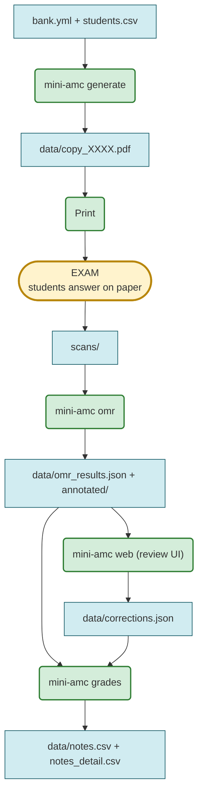

# mini-amc

[](https://github.com/boileaum/mini-amc/actions/workflows/ci.yml)
[](https://boileaum.github.io/mini-amc/)
[](https://boileaum.github.io/mini-amc/coverage/)
[](https://www.python.org/)
[](https://github.com/boileaum/mini-amc/blob/main/LICENSE)
[](https://mistral.ai/vibe)

A mini-clone of Auto-Multiple-Choice (AMC) based on Typst. 100% local data (student scans never leave the machine), zero external Typst packages, everything in English.

Developed by vibe-coding with [Mistral Vibe](https://mistral.ai/vibe) (every commit carries the `Co-Authored-By: Mistral Vibe` trailer).

## Features

- YAML question bank: single-answer MCQ + open (free-text) questions graded by the teacher (`type: open`, `max_points`)
- Personalized PDF copies: seeded reproducible shuffle of questions/choices, check bubbles + grade boxes, 4 corner alignment squares + per-page QR code on every page
- Optional nominative CSV (`--students`), Moodle-export friendly: link column and name columns configurable, delimiter auto-detected
- 100% local OMR (Optical Mark Recognition, OpenCV only): corners → homography → QR → bubbles/grade boxes, annotated scans, statuses `ok` / `needs_review` / `partial` / `unread`
- Review web UI (FastAPI): copy list, per-question detail, annotated scans, manual corrections (MCQ keys or open-question grade values)
- CSV grades: `notes.csv` (per copy, with student name) + `notes_detail.csv` (per question); bareme v1: 1 pt per correct MCQ, open question = blackened box value (0..max_points), no negative points

## Components

| Main component | Implementation |
| --- | --- |
| Copy generation | Python (seeded shuffle, QR PNGs) + Typst 0.15.1, zero external Typst packages |
| OMR reading (Optical Mark Recognition) | OpenCV (`cv2.QRCodeDetector`) + numpy, 100% local |
| Review web UI | FastAPI + uvicorn |
| Grading + CSV export | Python stdlib (`csv`) |

## Pipeline



## Install

Python >= 3.12 + [uv](https://docs.astral.sh/uv/):

```bash
uv sync --all-groups    # .venv with the project + pinned deps (committed uv.lock)
```

Typst CLI pinned to v0.15.1 (official binary; per-OS archives on the [releases page](https://github.com/typst/typst/releases/tag/v0.15.1)):

```bash
curl -L https://github.com/typst/typst/releases/download/v0.15.1/typst-x86_64-unknown-linux-musl.tar.xz -o /tmp/typst.tar.xz
tar -xf /tmp/typst.tar.xz -C /tmp && sudo mv /tmp/typst-x86_64-unknown-linux-musl/typst /usr/local/bin/
typst --version    # -> typst 0.15.1   (macOS: typst-aarch64-apple-darwin.tar.xz, or brew install typst)
```

## Quickstart

```bash
mini-amc generate --bank bank.example.yml --copies 30 --seed 42 --out data   # + --students students.csv (Moodle-friendly)
# print the PDFs, run the exam, scan the copies into scans/
mini-amc omr --scans scans --positions data/positions.json --out data/omr_results.json
mini-amc web --reload        # review UI -> http://127.0.0.1:8000/copies (interactive docs at /docs)
mini-amc grades --data data  # -> data/notes.csv + data/notes_detail.csv
```

Full guide: [quickstart](https://boileaum.github.io/mini-amc/quickstart.html) · exam-day checklist: [runbook](https://boileaum.github.io/mini-amc/runbook.html) · API reference: [api](https://boileaum.github.io/mini-amc/api.html) · scope and technical decisions: `SCOPE.md` in the repo.
