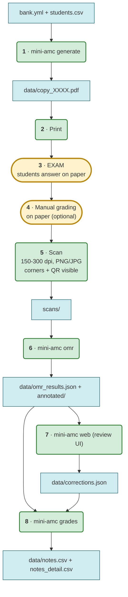

# mini-amc

A mini-clone of [Auto-Multiple-Choice](https://www.auto-multiple-choice.net) (AMC) based on [Typst](https://typst.app). 100% local data (student scans never leave the machine), zero external Typst packages.

## Features

- **Everything is local**: exam papers, student scans and grades never leave your machine
- **Write the exam once**, in a YAML question bank or directly in Typst with the `amc.typ` prelude (math, code blocks, split over several files, external files pulled in with `read()`): MCQ (single-answer or multi-answer) + open questions you grade on the paper copy (blacken one lettered box in the gray grader area)
- **Print one personalized PDF copy per student** (questions and choices shuffled differently on each copy)
- **Scan the returned copies**: answers are **read automatically (OMR)**, doubtful or ambiguous cases are flagged for review
- **Review doubtful copies** in a local web UI and correct them there, with the annotated scan next to the detected answers
- **Export the grades as CSV** (per copy with the student name, and per question), ready to import into your gradebook - Moodle-export friendly

## Components

| Main component | Implementation |
| --- | --- |
| Copy generation | Python (seeded shuffle, QR PNGs) + Typst 0.15.1, zero external Typst packages |
| OMR reading (Optical Mark Recognition) | OpenCV (`cv2.QRCodeDetector`) + NumPy, 100% local |
| Review web UI | FastAPI + uvicorn |
| Grading + CSV export | Python stdlib |

## Pipeline

Full guide: [quickstart](https://boileaum.github.io/mini-amc/quickstart.html) · exam-day checklist: [runbook](https://boileaum.github.io/mini-amc/runbook.html) · API reference: [api](https://boileaum.github.io/mini-amc/api.html) · scope and technical decisions: `SCOPE.md` in the repo.
